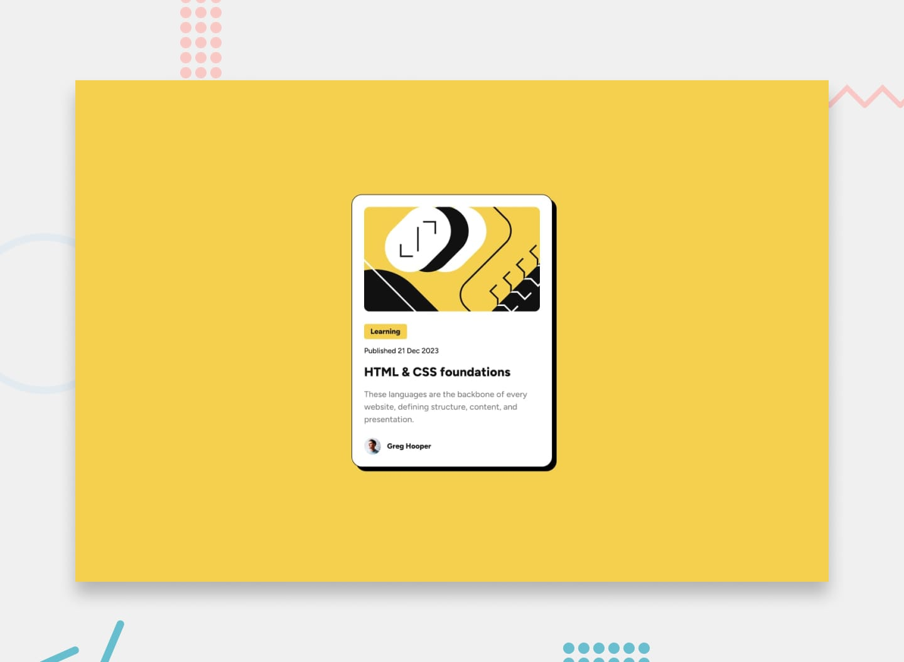

# Frontend Mentor - Blog preview card



## Table of contents

- [Overview](#overview)
  - [The challenge](#the-challenge)
  - [Links](#links)
- [My process](#my-process)
  - [Built with](#built-with)
  - [What I learned](#what-i-learned)
- [Author](#author)

## Overview

### The challenge

Your challenge is to build out this blog preview card and get it looking as close to the design as possible.

You can use any tools you like to help you complete the challenge. So if you've got something you'd like to practice, feel free to give it a go.

Your users should be able to:

- View the optimal layout depending on their device's screen size
- See hover and focus states for all interactive elements on the page

### Links

- Live Site URL: [github pages](https://GerardoCianciulli.github.io/blog-preview-card/)

## My process

### Built with

- Semantic HTML5 markup
- CSS custom properties
- CSS Grid
- Flexbox
- Desktop-first workflow
- Media Queries
- [React](https://react.dev/)
- [Typescript](https://www.typescriptlang.org/)
- [Vite](https://vite.dev/)
- [gh-pages](https://github.com/tschaub/gh-pages)

### What I learned

I learned how to keep a date both machine-readable and nicely formatted. The card takes an ISO date as a typed prop, puts it in the `dateTime` attribute of a `<time>` element, and formats the visible text with `Intl.DateTimeFormat`. Setting `timeZone: 'UTC'` matters: `new Date('2023-12-21')` is parsed as midnight UTC, so without it anyone west of UTC would see "20 Dec 2023".

```tsx
type BlogPreviewCardProps = {
  /** ISO date, e.g. "2023-12-21" */
  publishedDate: string
  // ...
}

const dateFormatter = new Intl.DateTimeFormat('en-GB', {
  day: 'numeric',
  month: 'short',
  year: 'numeric',
  timeZone: 'UTC',
})

<p className="blog-card__date">
  Published <time dateTime={publishedDate}>{dateFormatter.format(new Date(publishedDate))}</time>
</p>
```

Matching the design's spacing exactly taught me how Figma strokes differ from CSS borders. Figma draws the card's 0.0625rem stroke inside the frame without moving the content, but a CSS border takes up space. To keep the 1.5rem inset from the design, the padding is 1.4375rem plus the 0.0625rem border.

```css
.blog-card {
  max-width: 24rem;
  /* 0.0625rem border + 1.4375rem = the 1.5rem inset in the design */
  padding: calc(1.5rem - 0.0625rem);
  border: 0.0625 solid var(--color-gray-950);
  border-radius: 1.25rem;
  box-shadow: 0.5rem 0.5rem 0 var(--color-gray-950);
}
```

Every title on the page is an `h2`, so I added a visually hidden `h1` to give the page a top-level heading for screen readers without changing the design. Only the title changes state in the design, so it is the only element with hover and focus styles. Focus also gets an outline, because the yellow text alone is hard to see on white.

```css
.blog-card__link:hover,
.blog-card__link:focus-visible {
  color: var(--color-yellow);
}

.blog-card__link:focus-visible {
  outline: 0.125rem solid var(--color-gray-950);
  outline-offset: 0.25rem;
}
```

## Author

- Portfolio - [Gerardo Cianciulli](https://www.behance.net/gerardo-cianciulli)
- Frontend Mentor - [Gerardo Cianciulli](https://www.frontendmentor.io/profile/GerardoCianciulli)
- Linkedin - [Gerardo Cianciulli](https://www.linkedin.com/in/gerardo-cianciulli/)
